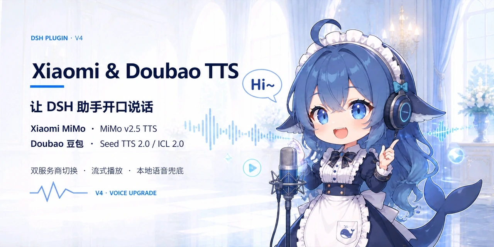

<h1 align="center">dsh-xiaomi-tts</h1>

<p align="center">
  <a href="https://awesome-dsh-plugin.com"></a>
  <a href="https://www.npmjs.com/package/dsh-xiaomi-tts"></a>
  
  <a href="https://github.com/deepseek-ai/deepseek-harness"></a>
</p>

> 为 DSH 添加 Xiaomi MiMo TTS、豆包 Seed TTS，浏览器语音；音频下载、 UI 音效、桌宠联动、QQBot 语音；

## 🎨 [在线预览](https://ppy-web.github.io/dsh-plugin-xiaomi-mimo-tts)

<p align="center">
  <a href="https://ppy-web.github.io/dsh-plugin-xiaomi-mimo-tts"></a>
</p>

> QQ 群 交流·建议：
>
> ```text
> 1104616387
> ```

## ✨ 功能

- 一键朗读与自动播报，过滤网址、代码等内容。
- 小米 MiMo、豆包流式语音，支持内置、自定义与复刻音色；浏览器语音可优先使用或兜底。
- 语速、音量、暂停与停止控制，音频历史试听和下载。
- 可选 UI 音效、宿主事件播报、第三方插件联动及鲸鱼娘 Agent 预设。

## 🚀 安装与使用

需要 DSH `0.2.2` 以上、Node.js 24.9+，当前适配目标为 DSH `0.2.2-alpha.2`。

在 DSH 插件管理面板搜索 `dsh-xiaomi-tts` 安装，或使用 Web 端命令：

```bash
dsh plugin --profile web add dsh-xiaomi-tts@latest
# 卸载
dsh plugin --profile web remove dsh-xiaomi-tts
```

[社区插件市场](https://awesome-dsh-plugin.com)中搜索 `xiaomi-mimo-tts`。

安装后可直接使用浏览器语音，**自动播报和 UI 音效默认关闭**。云端语音配置：

1. 打开插件设置，选择小米 MiMo 或豆包，填写并保存 [小米 Key](https://platform.xiaomimimo.com/console/api-keys) 或 [豆包 Key](https://console.volcengine.com/speech/new/setting/apikeys?projectName=default)。
2. 在“调音台”选择模型、音色，在“播报台”试听；密钥须先保存，模型和音色支持草稿试听。
3. 在「设置 → 语音朗读」调整音量、语速、朗读范围及自动播报、音效，与插件设置共用配置。

## 📖 用户手册

配置要点与详细使用说明见[用户手册](https://ppy-web.github.io/dsh-plugin-xiaomi-mimo-tts/#manual)。

## 🔌 插件联动

第三方插件通过可选服务调用语音，新播放会中断当前朗读：

```ts
import type { XiaomiMimoTtsService } from 'dsh-xiaomi-tts/client-api'

const tts = ctx.get('xiaomiMimoTts') as XiaomiMimoTtsService | undefined
tts?.play('欢迎回来')
// tts?.stop()
```

使用 `ctx.get()` 动态获取，避免声明必需注入；插件未安装、未就绪或关闭时跳过。

## 🔒 隐私

- API Key 由 DSH Host 保存，浏览器只读取配置状态；豆包由 Host 代理，文本和音色 ID 仅提交给所选服务商，费用按服务商政策计算。
- 本地语音使用 Web Speech API，音色与离线能力取决于浏览器和系统；在线音色可能向其语音服务发送文本。
- 云端音频存于浏览器 IndexedDB，最多 100 条 / 100 MB，可试听、下载；流式 PCM 保存为 24 kHz 单声道 WAV，本地语音无法导出。

## 🛠️ 开发

```bash
pnpm install --frozen-lockfile
pnpm dev          # 设置预览
pnpm build        # 构建插件
pnpm typecheck
pnpm test
pnpm dev:build    # 构建预览
pnpm pack:check   # 检查打包内容
```

## 🤝 推荐

- [dsh-deep-whale](https://github.com/Small-tailqwq/dsh-deep-whale#readme) · 鲸鱼娘主题皮肤系列。
- [dsh-whale-musume](https://github.com/Sutera-Diffusus/dsh-whale-musume#readme) · 元气鲸鱼娘桌宠。`已联动`
- [dsh-pet](https://github.com/PC2005-cloud/dsh-pet#readme) · 蓝色大肥鱼桌宠，支持联动。`已联动`
- [dsh-qqbot](https://github.com/tencent-connect/dsh-qqbot#readme) · 腾讯官方QQ机器人插件。`已联动`
- [dsh-plugin-uisfx](https://github.com/XanthanL/dsh-plugin-uisfx#readme) · 语义化 UI 音效。`已内置`
- [dsh-dream-skin](https://github.com/RevolutionLA/dsh-dream-skin#readme) · 原生换肤、背景壁纸、强调色和主题包。
- [deepseek-chan-meme-pack](https://github.com/the-beating-light-of-the-nail/deepseek-chan-meme-pack) · 鲸鱼娘Agent预设 - 人设参考 
- [✈️𝘾𝙤𝙠𝙚𝘾𝙡𝙤𝙪𝙙](https://vip.ih004.com/#/register?code=UHKslrCy) · 一个稳定的🪜

<a href="https://www.star-history.com/?repos=ppy-web%2Fdsh-plugin-xiaomi-mimo-tts&type=timeline&logscale=&legend=bottom-right">
 <picture>
   <source media="(prefers-color-scheme: dark)" srcset="https://api.star-history.com/chart?repos=ppy-web/dsh-plugin-xiaomi-mimo-tts&type=timeline&theme=dark&legend=bottom-right" />
   <source media="(prefers-color-scheme: light)" srcset="https://api.star-history.com/chart?repos=ppy-web/dsh-plugin-xiaomi-mimo-tts&type=timeline&legend=bottom-right" />
   
 </picture>
</a>
