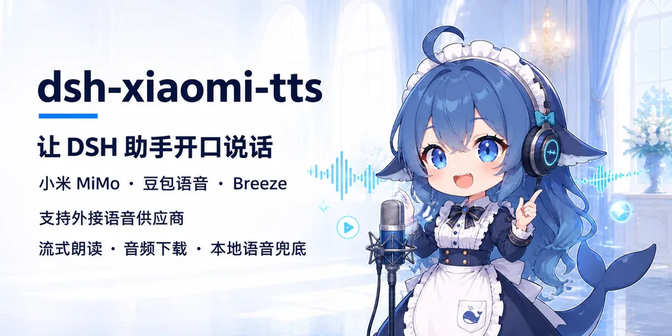

<h1 align="center">音色工坊 · dsh-xiaomi-tts</h1>

<p align="center">
  <a href="https://awesome-dsh-plugin.com"></a>
  <a href="https://www.npmjs.com/package/dsh-xiaomi-tts"></a>
  
  
  
  <a href="https://github.com/deepseek-ai/deepseek-harness"></a>
</p>

> 小米 MiMo、豆包语音、BreezeBlue、DeepSeek、本地 MOSS 与浏览器语音 — 音色随心配，支持连接 10+ 语音引擎，涵盖流式朗读、实时字幕响应球、趣味音效、多角色录音棚（`/director` 有声剧合成）及桌宠、听书、QQ Bot、AI Passport 联动

## 🎨 [在线预览](https://ppy-web.github.io/dsh-plugin-xiaomi-mimo-tts)

<p align="center">
  <a href="https://ppy-web.github.io/dsh-plugin-xiaomi-mimo-tts"></a>
</p>

> QQ 群 交流·建议：
>
> ```text
> 1104616387
> ```

## ✨ 功能

- **流式朗读与智能过滤**：一键朗读、自动播报，自动跳过网址、文件路径、代码块与公式，省流又顺耳；
- **云端 + 本地 10+ 语音引擎**：内置小米 MiMo（含音色设计）、豆包语音（含声音复刻）、BreezeBlue、DeepSeek，支持浏览器本地与 MOSS-Nano 本地模型兜底，还可通过外部适配器接入更多供应商；
- **多角色「录音棚」与 `/director` 导演模式**：跨剧本共享多引擎角色库，支持积木卡片与纯文本剧本互转、逐句连播审听、后台断点续录导出完整 WAV 有声剧；对话中输入 `/director` 上传文章、小说或文案即可编排并录制；
- **字幕、响应球与个性化体验**：输入栏上方支持实时字幕与多风格交互响应球（Aura Field / Siri Wave Line / Siri Sheet），支持自定义立绘卡、音色头像风格、语音指令预设（含说书人等）、UI 音效及宿主事件提醒；
- **语音识别与音频仓库**：内置小米、豆包、DeepSeek 云端 ASR 供宿主与 AI Passport 选用，支持语速/音量/朗读范围调节与音频历史筛选回放、下载；
- **丰富插件生态联动**：支持桌面宠物、小说听书、音乐播放器避让、音频响应频谱、移动端 `dsh-Go`、QQ Bot 传声筒与 AI Passport 随身语音终端。

## 🚀 安装与使用

需要 DSH `0.2.2` 以上（兼容 `0.2.2-rc.5`～`0.2.3-alpha.2`）、Node.js 24.9+。

- 直接在 DSH 插件管理面板搜索 `dsh-xiaomi-tts` 安装；

- 安装[插件市场](https://awesome-dsh-plugin.com)后搜索 `xiaomi-mimo-tts`。

- Web 端可使用命令：

    ```bash
    # 安装稳定版
    dsh plugin --profile web add dsh-xiaomi-tts@latest

    # 安装预发布预览版（含最新录音棚等抢先特性）
    dsh plugin --profile web add dsh-xiaomi-tts@next
    ```

- 卸载：

  ```bash
  dsh plugin --profile web remove dsh-xiaomi-tts
  ```

快速设置：

1. 侧边栏插件 → 已安装插件 → **音色工坊** → 进入设置页，默认使用[小米 MiMo](https://platform.xiaomimimo.com?ref=GQDDDU)，可在右上角卡片切换[豆包 Key](https://console.volcengine.com/speech/new/setting/apikeys?projectName=default)、[Breeze Key](https://breezeblue.ai/zh?code=JHKLSJ) 或 DeepSeek（在「播报台 → 语音服务商」开启）；
2. 在「调音台」选择模型、音色和语音指令，在「播报台」试听与下载；各服务商的密钥、音色与模型各自独立保存，先保存，后试听；
3. 想体验多角色有声剧？打开「录音棚」挑一部内置示例即可试听/开录，或在对话里输入 `/director` 让 AI 当导演帮你编排剧本；
4. 稳定使用 Breeze 需要科学上网，推荐 [✈️𝘾𝙤𝙠𝙚𝘾𝙡𝙤𝙪𝙙](https://vip.ih004.com/#/register?code=UHKslrCy)。

## 📖 用户手册

配置要点、录音棚、语音识别与各组件详细使用说明见[用户手册](https://ppy-web.github.io/dsh-plugin-xiaomi-mimo-tts/#manual)（仓库内源码见 [handbook.md](handbook.md)）。

## 🔌 插件联动

本插件向外部提供查询和调用接口，完整接入方式见[开放能力接口文档](open-api.md)。

- **浏览器插件**：通过 `ctx.xiaomiMimoTts.play(text)` 在当前页面播放，使用 `stop()` 停止，支持通过 `getPcmPlaybackSource()` 读取流式 PCM 分析节点。
- **宿主插件**：注入 `speechSynthesis` / `speechStudio`，通过 `ctx.speechSynthesis` 查询能力、合成或导出音频，也可注册交付渠道或外部语音供应商。
- **DSH Agent**：挂载 `dsh-xiaomi-tts/speech-agent` 使用 `speak`、`synthesize_speech` 和 `speech_mode`；挂载 `dsh-xiaomi-tts/studio-agent`（或使用 `/director` 命令）调用 `studio_inspect`、`studio_save_role`、`studio_save_script`、`studio_import_script` 与 `studio_task_control`。
- **外部程序或设备**：配置 `openApiToken` 后，通过 HTTP 查询能力、导出音频、管理录音棚（`/open-studio`）并使用限时 URL 下载。

- [dsh-whale-musume · 元气鲸鱼娘桌宠](https://github.com/Sutera-Diffusus/dsh-whale-musume#readme) 支持互动气泡播报 `已联动`
- [dsh-pet · 蓝色大肥鱼桌宠](https://github.com/PC2005-cloud/dsh-pet#readme) 支持播报碎碎念，闲聊消息 `已联动`
- [dsh-qqbot · 腾讯官方QQ机器人](https://github.com/tencent-connect/dsh-qqbot#readme) 支持向 QQ 推送语音和表情包 `已联动`
- [dsh-novel · 小说阅读与听书](https://github.com/xrn1997/dsh-novel#readme) 使用本插件朗读里面的小说 `已联动`
- [dsh-music-panel · 音乐播放器](https://github.com/Aliboder/dsh-music-panel) 播报时可以自动降低播放器的音量 `已适配`
- [dsh-Go · dsh 移动端移植](https://github.com/ccch1mneyyy/dsh-Go) 在移动端也可使用本插件 `已适配`
- [dsh-audio-reactive · 音频响应](https://github.com/ppy-web/dsh-audio-reactive) 随流式播报显示跳动的频谱背景 `已适配`
- [dsh-speech-provider-adapter · 供应商适配器](https://github.com/ppy-web/dsh-speech-provider-adapter#readme) 接入你想要的语音供应商 `已适配`
- [WhaleTalk Passport · 鲸语通行证](https://github.com/ppy-web/whaletalk-passport#readme) AI Passport 硬件连接，和你的鲸鱼娘实时语音对话 `已联动`

一个简单的调用示例：

```ts
import type { XiaomiMimoTtsService } from 'dsh-xiaomi-tts/client-api'

const tts = ctx.get('xiaomiMimoTts') as XiaomiMimoTtsService | undefined
tts?.play('欢迎回来')
// tts?.stop()
```

## 🔒 隐私

- API Key 由 DSH Host 保存，浏览器只读取配置状态；内置云端服务商均由 Host 代理，文本和音色 ID 仅提交给所选服务商，费用按服务商政策计算。
- 本地语音使用 Web Speech API 或本机部署的 MOSS 服务；浏览器在线音色可能向其语音服务发送文本。
- 浏览器端云端音频存于 IndexedDB，最多 100 条 / 100 MB，可试听、下载；流式 PCM 保存为 24 kHz 单声道 WAV，本地语音无法导出。录音棚角色、剧本与成品 WAV 存储在本地 `~/.dsh-xiaomi-tts/studio/`，上限 1 GB。

## 🛠️ 开发

```bash
pnpm install --frozen-lockfile
pnpm dev          # 设置预览
pnpm build        # 构建插件
pnpm typecheck
pnpm test
pnpm dev:build    # 构建预览
pnpm pack:check   # 检查打包内容
```

<a href="https://www.star-history.com/?repos=ppy-web%2Fdsh-plugin-xiaomi-mimo-tts&type=timeline&logscale=&legend=bottom-right">
 <picture>
   <source media="(prefers-color-scheme: dark)" srcset="https://api.star-history.com/chart?repos=ppy-web/dsh-plugin-xiaomi-mimo-tts&type=timeline&theme=dark&legend=bottom-right" />
   <source media="(prefers-color-scheme: light)" srcset="https://api.star-history.com/chart?repos=ppy-web/dsh-plugin-xiaomi-mimo-tts&type=timeline&legend=bottom-right" />
   
 </picture>
</a>
