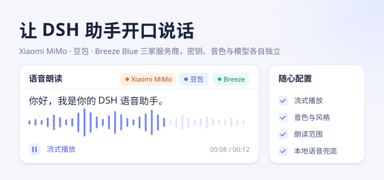

<!-- 此文档用于展示插件封面，由用户手动维护，禁止写入 -->

[功能预览 · 使用帮助](https://ppy-web.github.io/dsh-plugin-xiaomi-mimo-tts) - [配套固件 · 鲸语通行证](https://github.com/ppy-web/whaletalk-passport#readme) - [配套插件 · 供应商适配器](https://github.com/ppy-web/dsh-speech-provider-adapter#readme)