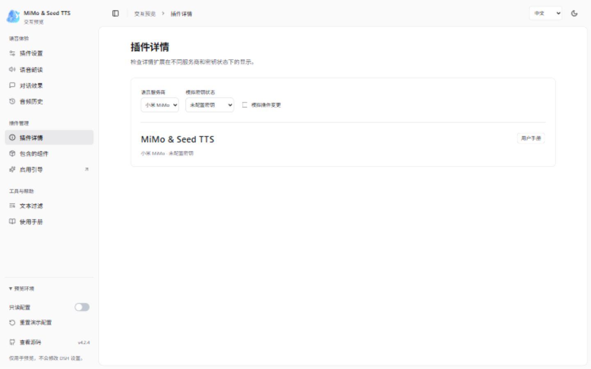
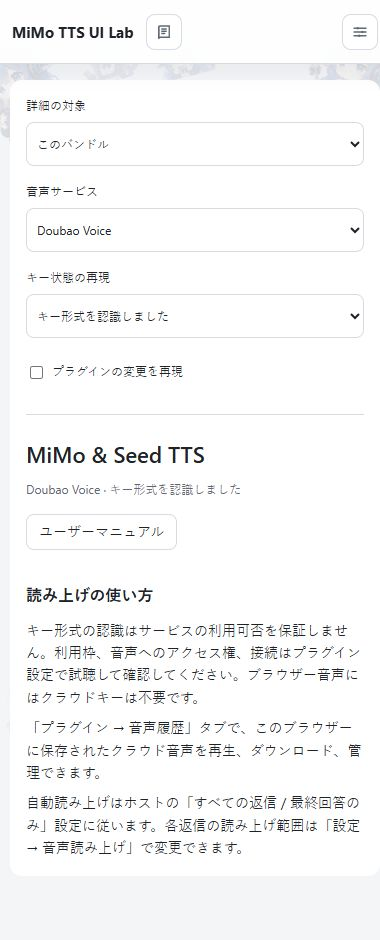
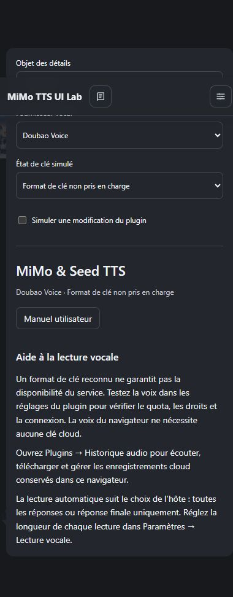
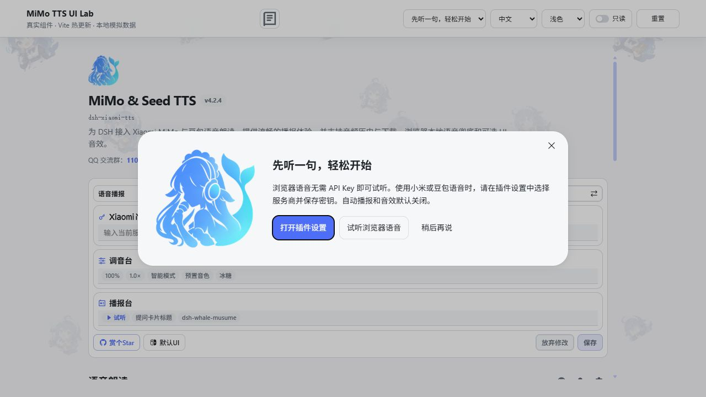
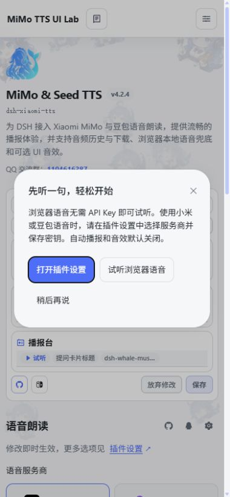
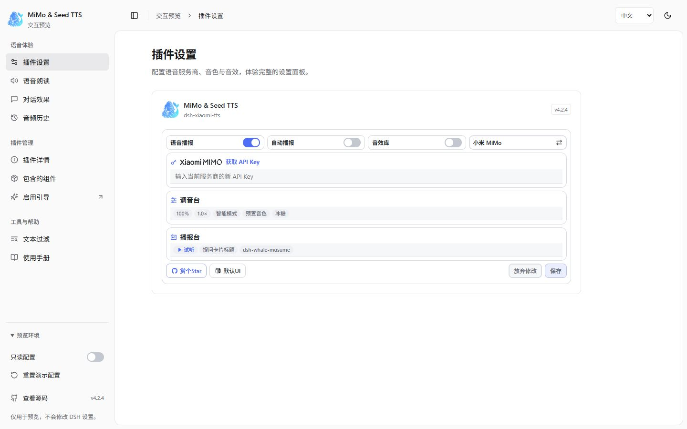
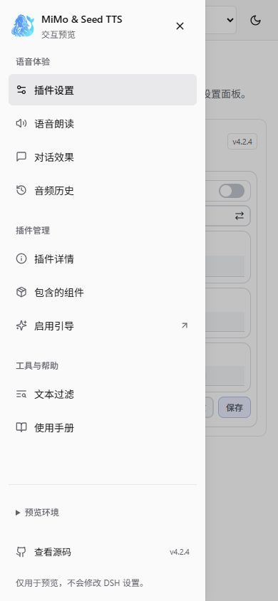
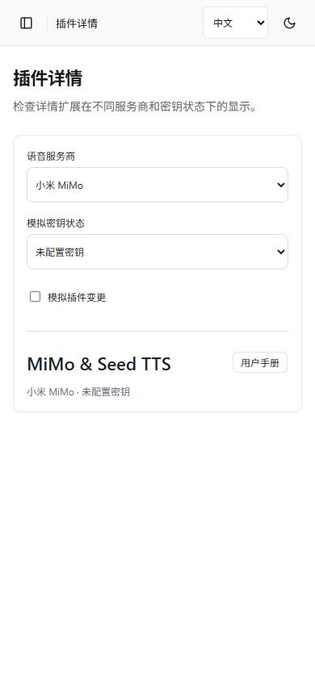

# 插件详情页扩展 Plan

状态：已实施。详情页的手册动作、密钥状态与使用帮助已完成；真实宿主 GUI 回归仍待验证。激活引导、历史标签页、插件变更订阅和原生更新分工由前置提交提供。

## 目标与边界

详情页帮助用户确认当前语音能否使用，并找到手册和设置入口。复用现有配置与密钥状态查询；更新、安装来源、版本、启停和卸载由宿主负责，不增加自研更新检查。

贡献仅在 `subject.kind === 'bundle' && subject.pkg.name === 'dsh-xiaomi-tts'` 时显示。其他包、组件行和官方条目返回 `null`，避免出现在无关页面。

## 槽与内容

| 宿主槽 | 已实现内容 | 数据与操作 |
|---|---|---|
| `plugins.detail.actions` | 「用户手册」按钮 | 打开仓库中的 `handbook.md`，沿用现有 GitHub 仓库地址；不复制宿主更新、版本、开关或卸载按钮 |
| `plugins.detail.badge` | 当前服务商的密钥状态 | 复用已保存 provider 与密钥状态接口，区分检查中、未配置、格式不支持、无法检查；格式有效只表示格式已识别，不宣称服务可用 |
| `plugins.detail.section` | 简短的使用帮助 | 说明「插件 → 音频历史」入口、自动朗读与宿主回复偏好的关系；页首提供手册链接，不复制整个设置表单 |

海报继续由 `meta.detail → intro.md` 提供，配置仍由 `plugins.bundle.config` 提供。新贡献使用宿主 Button、状态文字、布局变量和四语言字典，沿用现有视觉。

## 实施顺序

1. 将现有密钥状态读取抽成共享 observable：以 provider 为键缓存，在订阅结束和插件变更时取消请求，结束变更后刷新。配置卡、独立语音设置页和徽标复用同一来源，避免各自发请求。
2. 新增详情贡献组件，使用 `PluginDetailProps` 与真实 subject 过滤，只注册上述三个槽；显式开关操作继续走宿主。
3. 将配置卡里的源码链接等入口与详情动作对照去重。手册说明维护在 `handbook.md`，不修改 README。
4. 复用 `pluginChanges.bundle('dsh-xiaomi-tts')`：变更中显示状态并禁用依赖插件就绪的动作，保留纯外链；完成后刷新，卸载时清理订阅。
5. 补中、英、日、法文案和预览场景；验证目标版本槽注入后再做宿主人工回归。

## 已核实的限制

- 目标宿主的 `pluginNavigation` 只有 `openBundle` / `openList`，没有公开的指定标签页跳转接口。因此不放置会伪装成「直接打开历史」的按钮，不模拟 DOM 点击，不访问宿主内部导航 store；帮助文字告知用户选择「音频历史」标签即可。
- `meta.detail` 的相对 Markdown 链接在宿主中不会成为导航入口。手册动作应使用普通外部仓库链接；不要给出无法打开的包内相对链接。
- API Key 格式检查不能证明额度、音色权限或供应商连接成功，徽标文案必须区分这些状态。
- 禁用或卸载插件会撤销该插件注册的贡献，页面不应依赖它们提供宿主基本管理能力。

## 验收

- 其他包和组件详情不出现本插件的按钮、徽标、帮助区域。
- provider 切换、保存密钥、插件变更和连接恢复后状态正确；旧请求不能覆盖新状态，不显示密钥内容。
- 宿主版本与更新区域只出现一份，无自研版本查询、计时轮询或重复入口。
- 手册链接有效，历史入口描述与真实标签一致；只读设置不被详情动作绕过。
- 键盘可操作；中、英、日、法与窄屏、深色预览通过；卸载后无订阅、网络请求或音频残留。
- `pnpm typecheck`、聚焦测试、`pnpm test`、`pnpm dev:build` 和 `pnpm pack:check` 通过。

接口依据：目标宿主 `ui-plugin-manager/src/client/slot-contract.ts`、`ui-plugin-manager/src/client/index.ts` 与 `ui-plugin-manager/README.md`。本方案不要求新增运行时依赖。

## 前置改动验证记录

2026-10-28：本方案尚未实施；其余已批准功能已完成开发，包括移除自研更新、原生激活引导、独立音频历史标签、插件变更订阅、宿主回复偏好协调及日法翻译。使用说明已维护在 `handbook.md`，README 未在本轮修改。

- 插件构建、全量测试 265/265、预览构建和打包检查通过；发布清单包含四语言包元数据、鲸鱼娘预设元数据与手册。
- 使用目标宿主详情读取源码验证四语言均选择 `intro.md`，引用图片存在。
- UI 机械检查未发现问题。截图未完成：本地浏览器工具被设置禁用，原生浏览器检查又因无法可靠识别当前 URL 被工具中止，未继续操作。
- 宿主安装、启用引导和 GUI 的最终验证由用户手动完成。本记录不代表真实宿主回归已通过。

## 详情扩展实施与验证记录

2026-10-28：已实现上述三个详情槽，使用目标宿主已安装声明中的 `PluginDetailProps`，严格过滤本插件的 bundle subject。没有增加版本查询、定时轮询、历史跳转伪按钮或运行时依赖。

- `ApiKeyStatusStore` 按服务商共享请求，配置卡、独立语音页、会话朗读和详情徽标统一订阅；最后一个订阅退出、宿主未就绪、插件变更或卸载时取消请求，丢弃过期响应。配置修订、连接恢复和变更结束后刷新，失败可重试。网络恢复只刷新状态，不触发保存密钥的播放中断事件。
- 徽标使用已保存的 provider；格式识别只说明格式受支持，帮助文字要求通过试听确认实际使用条件。纯手册链接在变更时保留；详情不修改配置，也不绕过只读权限。配置卡的源码支持入口与手册用途不同，未再增加重复源码动作。
- 四语言文案、手册及预览已同步。预览新增 provider、五种密钥状态、目标 / 其他组合包 / 组件 / 官方条目及变更开关。切换预览语言保留 provider、只读与模拟状态，重置按钮仍恢复默认值。
- 浏览器验证：目标对象显示三项贡献，其他三类对象的动作、状态和帮助数量均为零；查询失败显示重试，变更时隐藏重试并保留手册，结束后恢复；provider 切换及四语言切换正确。390px 窄屏的日语浅色、法语深色均无横向溢出。桌面及移动截图见下。
- `pnpm typecheck`、`pnpm test`（280/280）、`pnpm dev:build`、`pnpm pack:check` 均通过；UI 机械检查无发现，键盘 Tab 可聚焦手册入口。预览保留既有的 chunk 大小提示。包内包含 `handbook.md`、`intro.md`、四语言元数据与海报资源。
- 本次仅验证真实组件的独立预览及目标宿主槽契约。未操作用户的 DSH profile，也未将独立预览视为真实宿主安装、升级、卸载或供应商服务回归通过。

## 激活引导弹窗修复

2026-10-28：用户实测发现激活引导排在插件列表底部。核对目标宿主 `PluginManagerPage.tsx` 后确认：`plugins.bundle.activation` 只提供列表末尾的挂载点，插件必须自行提供弹窗。原实现只返回普通 section，遗漏了这一层。

现改用宿主 `Modal`，通过 Portal 挂到 body，沿用宿主遮罩、居中布局、关闭按钮与焦点管理。打开设置前和任意关闭路径均先停止试听。独立预览保留设置列表作为背景，并补上宿主图标 sprite 及弹窗主题变量，避免再次将普通内联布局误认作引导弹窗。

验证：1280×720 下弹窗与视口中心同为 (640, 360)，Portal 挂载和 aria-modal 正确；初始焦点进入设置按钮，Tab 在弹窗内循环。Esc、关闭按钮及点击遮罩均可撤销弹窗。390×844 窄屏下弹窗在视口内完整显示，按钮正常换行。`pnpm typecheck`、`pnpm test`（280/280）、`pnpm dev:build` 均通过；本记录为独立浏览器预览结果，不替代真实宿主回归。

布局调整：引导改为左右分栏，左侧使用 `assets/plugin-icons/avatar.webp`，复用已发布的同图静态资源；右侧保留标题、说明、三个操作及状态提示。桌面弹窗宽度为 780px，390px 窄屏仍保留左右关系并自动换行按钮，已验证头像加载、无横向溢出和 Esc 关闭。类型检查、280 项测试与预览构建通过，以下截图已更新为当前布局。

## 独立预览导航调整

2026-10-29：参考 shadcn Sidebar 的侧栏与内嵌内容布局，将插件设置、语音朗读、会话朗读、音频历史、插件详情、组件、文本过滤和手册拆成八个独立入口。激活引导通过独立按钮打开现有弹窗；页面支持 hash 直达、浏览器前进后退、面包屑与侧栏收起。1023px 及以下改用抽屉导航，环境模拟选项默认折叠。

仅改造预览外壳，继续使用真实插件组件和宿主基础组件，没有增加运行时依赖。视觉方向沿用 framed-sheet（seed 1086428086）。已通过 CUA 浏览器检查 1440×900、768×1024、390×844、深浅主题、四语言、导航返回、手册目录、只读与重置；未发现横向溢出。静态样式检查 0 FAIL / 0 WARN，预览构建和 280 项测试通过；保留既有 chunk 大小提示。未操作真实 DSH profile。

## 详情页精简

2026-10-29：按用户反馈，独立预览固定展示本插件，移除「详情对象」选择。真实插件和预览同时移除「语音使用帮助」区域，撤销 `plugins.detail.section` 注册并清理四语言无用文案。密钥状态和失败重试继续保留。

「用户手册」直接复用宿主 `Button` 的 `outline` / `sm` 样式及交互，不再维护自绘链接按钮。浏览器已验证原网站首页跳转，模拟插件变更时入口仍可用，1440px 桌面及 390px 深浅主题均无横向溢出；280 项测试和预览构建通过。随后按用户要求，将地址补为 `https://ppy-web.github.io/dsh-plugin-xiaomi-mimo-tts/#manual`，直接进入手册路由，并同步测试预期和手册说明；用户已确认功能可用，此链接调整未再执行验证。

