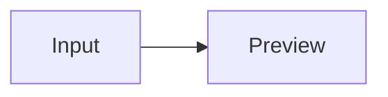

# DSH Web Markdown 兼容样例

在宿主打开完整 `.md` 文件可检查 YAML 元数据和正文渲染。测试聊天渲染时，从本标题开始使用正文；聊天不会提取文件头的 YAML。预览项目的「文本过滤测试」会把整份文件作为一段输入，便于保留链接、图片和脚注的引用关系。

## 标题、段落与行内样式

### 三级标题 ###

#### 四级标题

##### 五级标题

###### 六级标题

Setext 一级标题
===============

Setext 二级标题
---------------

海风吹过码头，*斜体*、_下划线写法的斜体_、**粗体**、__下划线写法的粗体__、***粗斜体***，都在同一段。**注意：**紧跟中文时也能正确结束粗体。

原定~~下午出发~~，现改为早上出发。范围 10~20 和 ~单个波浪号~ 保持原样。

行内代码 `voice = 'demo'`，以及含反引号的代码 `` `demo` ``。反斜杠转义 \*普通星号\*，实体 &amp;、&#169;、&#x1F30A; 会解码。

软换行前半句
仍属于同一段。这里是硬换行的第一行。\
这是硬换行后的第二行。

空行把这句分成另一个段落。

***

## 引用与列表

> 一级引用可以含有 **行内样式**。
>
> > 二级引用保留独立层级。
>
> - 引用中也可以放列表。

- 无序列表第一项
  - 嵌套的无序列表
  - 并列子项
- 无序列表第二项

3. 有序列表从 3 开始
   - 有序列表中嵌套无序列表
4. 下一个有序项

5) 右括号编号也可以开始有序列表
6) 下一个有序项

- 松散列表的第一项。

  同一项内的第二段，和第一段之间有空行。

- 松散列表的第二项。

- [x] 已完成：收集文本样例
- [ ] 未完成：检查渲染结果
  - [X] 嵌套任务：确认复选框只展示状态

## 表格

| 样例 | 进度 | 数量 |
| :--- | :---: | ---: |
| 中文正文 | **就绪** | 12 |
| 转义竖线：甲\|乙 | `a\|b` | 3 |
| 行内公式 | $x^2$ | |

四列及以上的表格可横向滚动；缺失的单元格补空，多出的单元格省略。

| 项目 | 状态 | 用途 | 备注 |
| --- | :---: | --- | --- |
| 宿主会话正文 | 就绪 | 检查内容渲染 | 一段可以用来观察窄窗口横向滚动的较长说明文字 |
| 缺列样例 | 待查 |
| 多列样例 | 就绪 | 对照 | 保留到这里 | 这列应被省略 |

> 引用内的四列表格按引用宽度排版。
>
> | 甲 | 乙 | 丙 | 丁 |
> | --- | --- | --- | --- |
> | 春 | 夏 | 秋 | 冬 |

| 只有表头 | 没有数据行 |
| --- | --- |

## 网页链接、自动链接与文件链接

[普通链接](https://example.com/ "示例网站")、[完整引用链接][manual]、[项目主页][]和[manual]。

尖括号自动链接：<https://example.com/>、<preview@example.com>。裸链接与邮箱：访问 https://example.com/，也可访问 www.example.com 或联系 preview@example.com。

只含完整 HTTP(S) URL 的行内代码 `https://example.com/?preview=voice` 可以点击；命令 `curl https://example.com/` 保持普通代码。

本地文件链接由宿主的文件预览处理。会话工作目录为本项目根目录时，可以点开下面的相对路径；绝对路径是格式样例。

- [相对路径](./handbook.md)
- [行号](./src/client/playback/speech-text.ts#L4)、[行范围](./src/client/playback/speech-text.ts#L4-L8)
- [冒号行号](./src/client/playback/speech-text.ts:4)、[行列](./src/client/playback/speech-text.ts:4:1)、[冒号行范围](./src/client/playback/speech-text.ts:4-8)
- [POSIX 绝对路径](/workspace/mock/preview.md:3)、[Windows 绝对路径与空格](<C:\Mock Workspace\.notes\preview.md#L3>)、[百分号编码路径](./mock-assets/My%20Notes.md#L2)

行内路径 `src/client/playback/speech-text.ts` 在宿主能匹配到对应文件时也可以点击。

[manual]: https://github.com/ppy-web/dsh-plugin-xiaomi-mimo-tts/blob/main/handbook.md "项目用户手册"
[项目主页]: https://github.com/ppy-web/dsh-plugin-xiaomi-mimo-tts

## 图片

远程 HTTPS 图片、作为链接的图片，以及引用式图片：


[![打开项目主页的图标][logo]](https://github.com/ppy-web/dsh-plugin-xiaomi-mimo-tts)

文件预览以当前文档所在目录解析相对图片路径。下面是仓库里已有的图片：

![本地插件图标][local-icon]

下面的本地图片路径特意不存在，用来观察替代文字。最后一项是宿主识别的独占一段、未转义的带空格路径。


[logo]: https://raw.githubusercontent.com/ppy-web/dsh-plugin-xiaomi-mimo-tts/main/assets/mimo.svg
[local-icon]: ../../../assets/plugin-icons/avatar.webp

## 代码块

反引号围栏指定语言，宿主为已知语言提供代码高亮：

```typescript
const greeting = '早上好，今天适合出发'
console.log(greeting)
```

波浪线围栏、无语言围栏、缩进代码块和空围栏：

~~~json
{ "status": "ready", "count": 3 }
~~~

```
这一行是无语言代码块中的原文。
```

    这一行以四个空格缩进，也是代码块。

```text
```

未知语言保留为纯文本代码：

```mock-language
ready: true
```

## LaTeX 数学公式

宿主在流式输出结束后渲染公式。行内公式可用美元符号 $E = mc^2$ 或反斜杠圆括号 \(\frac{1}{2}\)。转义后的价格 \$12.50 和行内代码 `$x^2$` 保持原样。

多行美元围栏：

$$
\sum_{k=1}^{4} k = 1 + 2 + 3 + 4 = 10
$$

独占一行的美元围栏：

$$x^2 + y^2 = r^2 \tag{1}$$

反斜杠方括号可以写在一行，也可以跨行：

\[\sqrt{9} = 3\]

\[
\begin{aligned}
f(x) &= x^2 + 2x + 1 \\
     &= (x + 1)^2
\end{aligned}
\]

`math` 围栏在流式结束后也会变成块级公式：

```math
\int_0^1 x\,\mathrm{d}x = \frac{1}{2}
```

## 脚注

海风预报来自模拟观测[^forecast]。同一脚注可重复引用[^forecast]，也可以引用第二条说明[^scope]。

[^forecast]: 这条脚注会在文末显示一次，并保留 **强调内容**。

    缩进的续段仍属于这条脚注。

[^scope]: 这里的数据只用于本地预览。

## 不做特殊渲染的对照

行内 HTML：<mark>这段不会套用 HTML 的高亮样式</mark>。

<div>
HTML 块也不会被插入为可交互的网页内容。
</div>

<!-- 这也是原始 HTML，而不是宿主专用指令。 -->

[纯锚点保留为文本](#标题)、[数据地址保留为文本](data:text/plain,mock)。

> [!NOTE]
> GitHub 提示块在这里仍是普通引用。



Mermaid 围栏显示代码，不绘制流程图。
